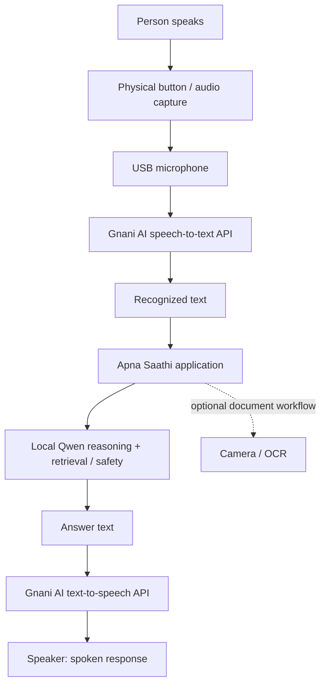

<div align="center">

# APNA SAATHI
### AI that speaks your language. Technology that meets you where you are.

**A voice-first, multilingual edge-AI companion for people left behind by text-heavy, English-first digital services.**

**Built for the [Great Indian AI Internship Challenge](https://www.gnani.ai/great-indian-ai-internship-registration-form) · Powered by Gnani AI speech integration + local AI reasoning**

[](https://www.gnani.ai/great-indian-ai-internship-registration-form)


</div>

---

## What if access to AI didn't require a smartphone, fluent English, or typing?

Imagine a parent at a school meeting who understands the teacher's language only partially. A farmer trying to make sense of an unfamiliar government notice. A traveller who needs to communicate in a different Indian language. For each person, information may technically *exist*—but that does not mean it is *accessible*.

**Apna Saathi turns an intimidating digital interaction into a conversation.** Speak naturally, press a physical button, and hear an answer in a familiar language.

> **Our premise:** Accessibility is not merely making information available. It is making information understandable and usable.

## The build in 30 seconds

Apna Saathi is a working prototype of a **physical, voice-enabled AI assistant** on an **NVIDIA Jetson** device. The Gnani AI integration connects Indian-language speech recognition and speech synthesis to an on-device assistant, so a spoken question can travel from microphone to transcription, local reasoning, and spoken response.

**The distinctive part isn't another chatbot UI. It's the interaction:** a tangible device, physical controls, voice input and output, local inference, and practical scenarios designed around Indian users.

### Live demonstration

**[▶ Watch the 60-second demo](https://drive.google.com/drive/folders/1rITObumlxxv7eg6ds7E835D7uKrlckrb)**  · **[X launch post](https://x.com/akansha_u/status/2121936030026846437?a=eEMc37-AJe5E2MqjQ64&s=20)**


---

## Why this matters

| Barrier | Typical digital experience | Apna Saathi's approach |
|---|---|---|
| Language | English-first forms and interfaces | Ask and listen in a supported Indian language |
| Literacy | Reading, navigating and typing | Conversational voice interaction |
| Hardware access | Personal smartphone or laptop required | Shared, purpose-built handheld device |
| Connectivity | Cloud-dependent reasoning | Local reasoning capability; Gnani speech APIs currently require connectivity |
| Trust and usability | Complex, multi-step interactions | Physical controls and familiar spoken explanations |

### Who it is for

**Parents and teachers** navigating language differences; **farmers and rural households** seeking understandable information about public services; **travellers** communicating across languages; and **community facilitators** assisting people with limited digital literacy.

These are target use cases, **not claims of validated deployment or measured outcomes**. Field impact requires user testing.

---

## Gnani AI × Apna Saathi: the technical integration

The challenge calls for a working application that uses Gnani AI technology. This repository contains a configurable **Gnani ASR/TTS adapter** at [`python/pocketinfer/models/gnani.py`](python/pocketinfer/models/gnani.py), wired into the Apna Saathi application workflow.

| Layer | Technology | Responsibility |
|---|---|---|
| Speech-to-text | **Gnani AI ASR integration** | Convert captured speech into text |
| Reasoning | **Local Qwen-family LLM via on-device inference** | Interpret the request and generate a response |
| Text-to-speech | **Gnani AI TTS integration** | Return the answer as spoken audio |
| Input/output | USB microphone, speaker, hardware/UI controls | Human interaction without typing |
| Device | NVIDIA Jetson edge computer | Run the local application and reasoning stack |
| Supporting capabilities | OCR, retrieval, safety and multilingual components | Extend assistance to documents and information workflows |

**Model-name precision:** Gnani's challenge materials describe **Prisma v2.5** (ASR), **Timbre v2.5** (TTS), and **Evon v3.3** (LLM). The checked-in adapter uses configurable API endpoints; it **does not, by itself, prove which deployed Gnani model/version is serving a request**. Record the exact ASR/TTS model IDs shown in the Gnani dashboard or request configuration before claiming Prisma v2.5 or Timbre v2.5 specifically. **Evon is not claimed as the local reasoning model in this build.**

### Voice pipeline



**Connectivity disclosure:** The reasoning engine is designed for local inference, but **Gnani API-based STT and TTS need network access** in the current integration. The repository includes other local speech components, but a fully offline Gnani speech experience is **not** claimed.

### What makes this an engineering build

- **End-to-end voice loop:** microphone capture → Gnani speech API → local model → Gnani speech API → speaker.
- **Hardware-aware interface:** device interaction and physical controls rather than a browser-only mockup.
- **Modular model adapters:** speech providers and local AI components are separated from the application logic.
- **Realistic deployment constraints:** audio device selection, latency, networking, model memory, language handling and fallback paths matter on actual edge hardware.
- **Sensitive-domain guardrails:** the codebase includes safety-oriented handling; health and public-service answers must still be verified with authoritative sources.

---

## Four scenarios worth watching in the demo

**1. The parent–teacher meeting** — A parent asks for a simple explanation of a school-related message in a familiar language. Demonstrates accessibility and practical value.

**2. The traveller** — A person needs help understanding or phrasing a message across an Indian-language barrier. Demonstrates multilingual voice interaction.

**3. The government notice** — A user asks what an unfamiliar notice means and what steps may be needed. Demonstrates a useful public-service workflow; if camera/OCR is shown, show the actual document capture rather than implying an unimplemented feature.

**4. The mixed-language question** — A user naturally switches between Hindi and English. Demonstrate only with language combinations that the running Gnani endpoint actually handles; do not claim Hinglish, Tanglish or Benglish benchmarks without test evidence.

**Suggested 60-second demo sequence:**

| Time | What to show | Why it matters |
|---|---|---|
| 0–08s | A real-life language barrier, then the physical device | Hook: the problem is immediate |
| 08–22s | Speak a question into the device | Show genuine voice input |
| 22–38s | Show transcription → local processing → spoken answer | Prove Gnani integration and functionality |
| 38–50s | Second language or code-mixed exchange | Demonstrate Indian-language relevance |
| 50–60s | Device close-up, impact statement, project name | Memorable finish |

**For the challenge, authenticity matters more than effects.** Use uncut or clearly labelled demo footage, real device audio and honest timing.

---

## How to run the code

### Prerequisites

- A compatible NVIDIA Jetson / Linux environment and supported Python runtime
- Working microphone and speaker, with correct OS audio configuration
- Local reasoning model and inference runtime installed separately
- Gnani AI account, API credentials and endpoint details
- Network connectivity for Gnani ASR/TTS API calls
- Hardware-specific setup as described in [`python/README.md`](python/README.md) and [`rootfs/`](rootfs/)

### Clone

```bash
git clone https://github.com/AMSecretAgent/GNANI.AI.git
cd GNANI.AI
```

### Install the Python module

```bash
cd python
python3 -m venv .venv
source .venv/bin/activate
pip install -e .
```

The exact runtime may require additional Jetson, audio and model-specific packages. This is **not** a guaranteed one-command hardware deployment.

### Configure Gnani AI

```bash
cp .env.example .env
```

Edit `python/.env` locally to set your own `GNANI_API_KEY`, the actual `GNANI_ASR_URL` and `GNANI_TTS_URL`, and the authentication/response settings required by your account. **Do not commit `.env`, tokens or credentials.** The example file is a template, not a ready-to-use provider contract.

> **Integration note:** The checked-in Gnani adapter is explicitly configurable. Confirm payload shape, headers, model IDs and response fields against the current [Gnani developer documentation](https://docs.gnani.ai/) before running on a new account. The deployed Jetson environment may include additional runtime-specific configuration not represented by the example alone.

### Where to look in the code

| File | Purpose |
|---|---|
| [`python/pocketinfer/applications/apna_saathi.py`](python/pocketinfer/applications/apna_saathi.py) | Main assistant application and conversation workflow |
| [`python/pocketinfer/models/gnani.py`](python/pocketinfer/models/gnani.py) | Gnani AI speech integration adapter |
| [`python/pocketinfer/audio.py`](python/pocketinfer/audio.py) | Audio capture and playback helpers |
| [`python/pocketinfer/boards/`](python/pocketinfer/boards/) | Hardware abstraction |
| [`python/pocketinfer/ui/`](python/pocketinfer/ui/) | Device interface |
| [`python/pocketinfer/retrieval.py`](python/pocketinfer/retrieval.py) | Local information retrieval |
| [`python/pocketinfer/ocr.py`](python/pocketinfer/ocr.py) | Document-text processing |
| [`python/pocketinfer/safety.py`](python/pocketinfer/safety.py) | Safety-oriented response handling |
| [`ioexpander/`](ioexpander/) | Peripheral/UI firmware resources |
| [`rootfs/`](rootfs/) | Provisioning and deployment resources |

Large model weights and machine-specific configuration are not distributed in this repository. **Do not replace or restart an existing production service just to test this development checkout.**

---

## Testing: evidence over adjectives

The next evaluation milestone is to publish a small, reproducible voice test set across **Hindi**, **English**, and any additional **actually tested** Indian language or code-mixed combinations.

| Metric | How to measure | Status |
|---|---|---|
| End-to-end completion | Successful question → spoken response | Prototype demonstrated; publish test count |
| Transcription accuracy | Word error rate / qualitative transcript review | Not yet published |
| Response latency | Median and P95 from end of speech to first audible response | Not yet published |
| Code-mixed handling | Fixed Hindi–English prompts, same device and environment | Not yet published |
| Noise robustness | Quiet vs. realistic background noise | Not yet published |
| User accessibility | Task success and feedback from intended users | Not yet published |

No fabricated accuracy, latency, adoption or user-study numbers are presented here. The challenge's published model benchmarks are **Gnani AI's claims**, not measurements of this device.

---

## Challenge fit

This project is positioned around the following **Great Indian AI Internship Challenge** award themes:

| Award | Evidence to emphasize |
|---|---|
| **Real Deal Award** | Practical language/literacy barriers, physical demonstration, specific beneficiary scenarios |
| **Jugaad Genius Award** | Creative combination of Gnani speech services with a compact edge-AI device |
| **Main Character Award** | A tested low-resource Indian-language interaction, ideally with a genuine native-speaker demo |
| **Mixed Vibes Award** | Verified, natural code-mixed speech in the working prototype |
| **Demo Day Drop Award** | Clear, authentic 60-second public demo |

Award selection is independent of this README and cannot be guaranteed. Challenge rules permit **at most one award per participant/team**.

**Challenge submission reminder:** The published deadline was **15 November 2026, 18:00 IST**. A public LinkedIn/X post with `#GnaniAI` and `#GreatIndianAIInternshipChallenge`, plus the formal submission, was required. Updating a repository after the deadline does not itself extend submission eligibility.

---

## Origins, responsibility and credits

Apna Saathi builds on the **Suno Sutra / PocketInfer** hardware and software ecosystem. The original repository components and required attribution remain governed by the included [`LICENSE`](LICENSE), including the **2026 Current AI** copyright notice. The Gnani integration and Apna Saathi application are presented here as project-level additions and adaptations; this README does not imply endorsement by the original authors or Gnani AI.

**Project lead:** Akansha Mishra  
**Project:** Apna Saathi  
**Challenge:** Great Indian AI Internship Challenge 2026  
**Contact:** [mishakansha.01@gmail.com](mailto:mishakansha.01@gmail.com)

> **Built around one belief:** The next generation of Indian AI should not ask people to adapt to technology. It should adapt to how people actually speak, learn and live.

**#GnaniAI · #GreatIndianAIInternshipChallenge · #VoiceAI · #EdgeAI · #IndianLanguages · #DigitalInclusion**
